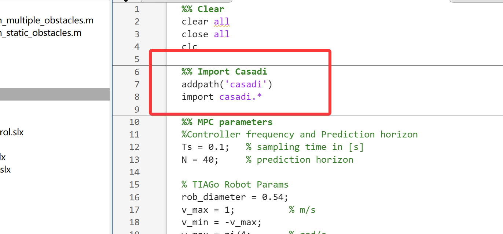
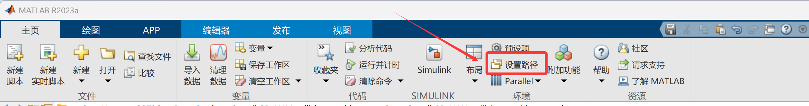
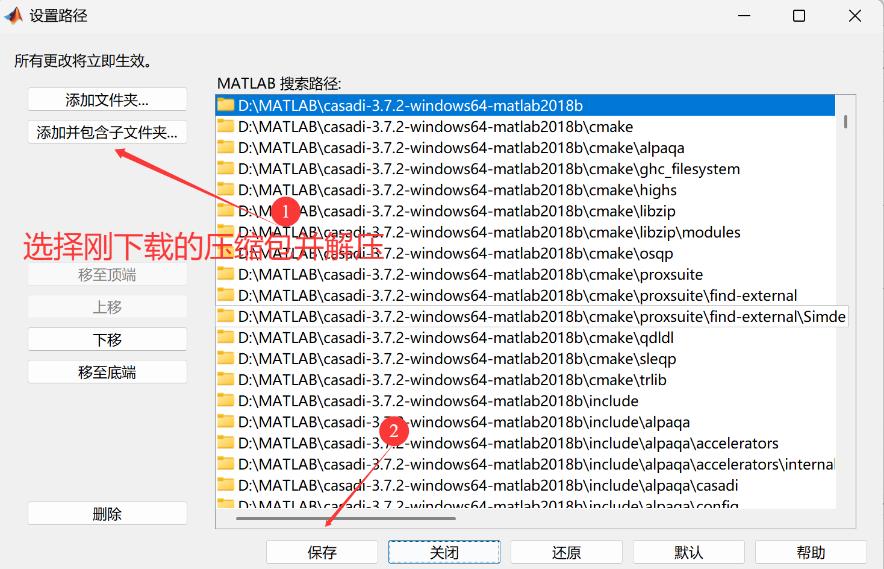

# [Matlab Installation of CASAD]

​  
💥💥💞💞 Welcome to this blog❤️❤️💥💥 🏆 Bloggers' Advantages: 🌞🌞🌞 The content of the blog strives for rigorous thinking and clear logic, making it convenient for readers. ⛳️ Mantra: "A journey of a thousand miles begins with a single step." 📋📋📋 The content of this article is as follows: 🎁🎁🎁 ⛳️ Gift to the readers
👨‍💻 In conducting scientific research, one encounters a profound intellectual system that requires researchers to be logically precise and diligent. However, it is not just about effort; oftentimes, leveraging external resources is more crucial than mere exertion. Additionally, there must be an innovative perspective and inspiration for looking up at the stars. Readership is advised to follow the directory in order, avoiding abruptly falling into a dark labyrinth without knowing how to return. It may not reveal all the answers to your questions, but if it can dispel the clouds of doubt that have arisen within you, it could transform into a beautiful sunset. If it brings you a heavy rain in the spiritual world, then take this opportunity to wash away the dust accumulated on the "sitting down" position. Perhaps, after the rain clears, the clear sky will become even more serene...🔎🔎🔎💥1 Overview
📚2 Running results CasADi is not a built-in toolbox of MATLAB, but an independent open source symbolic computation and automatic differentiation library that supports MATLAB/Octave, Python, and C++.
In MATLAB, "installing" CasADi only requires two steps:
Download the corresponding version of the binary package;
Add the unzipped folder to MATLAB's search path (permanently or upon startup).
The following are detailed steps under Windows / macOS / Linux (using MATLAB R2021a 64-bit as an example, the same applies to other versions).
Open the official website download page.
https://web.casadi.org/get/  
Locate the latest stable version (e.g., 3.6.3).
Select the MATLAB package corresponding to the platform.
Windows 64-bit:   
casadi-3.6.3-windows64-matlab2018b.zip  
macOS Intel:   
casadi-3.6.3-mac64-matlab2018b.tar.gz  
Linux 64-bit:   
casadi-3.6.3-linux64-matlab2018b.tar.gz  
The "2018b" in the filename is merely the lowest version used during official packaging, and R2018b and later versions are also available.
II. Unpacking - Unzip the archive to any path that does not contain Chinese characters or spaces, for example:
​  
​  
D:\toolbox\casadi-3.6.3-windows64  
Or
/home/yourname/casadi-3.6.3-linux64  
3. Adding paths in MATLAB
Open MATLAB, execute in the command line.
matlab  
Copy
>> addpath('D:\toolbox\casadi-3.6.3-windows64')  % Replace with your actual path
>> savepath   % Permanently write the path to startup.m, which will take effect automatically next time the program starts
If you do not execute savepath, then you will need to re-addpath every time MATLAB is restarted.  
Verify if it's successful  
matlab  
Copy
>> import casadi.*\n>> x = SX.sym('x');\n>> disp(x)\nx\n  
No error indicates that the installation is complete.
IV. Common Issues
The prompt "Cannot find casadiMEX"
This is most likely due to a wrong path or version mismatch (32-bit MATLAB using 64-bit CasADi).
Confirm that casadiMEX.mexw64 (Windows) or casadiMEX.mexa64 (Linux/macOS) exists in the directory you added.
Conflict with MATLAB's built-in sym
It is recommended to import casadi.* before using SX.sym, MX.sym, or explicitly write casadi.SX.sym to avoid name conflicts.
To uninstall
Simply delete the folder, then in MATLAB:
matlab
Copy
>> rmpath('D:\toolbox\casadi-3.6.3-windows64')\n>> savepath\n  
One sentence summary
"Download → Unzip → AddPath → SavePath" four steps can complete the installation of CasADi in MATLAB, without compiling.
🎉3 References
​  
​  

## Images

<!-- PAYMENT_BLOCK -->

## Get this dataset

- Payment link (Stripe): [Buy now](https://buy.stripe.com/3cs8yP7sY87d0vu9AB)
- Payment QR code: 

<!-- /PAYMENT_BLOCK -->
